# E-Commerce Customer Analytics: Phân khúc khách hàng để tối ưu Marketing và giữ chân khách

> **Công cụ:** SQLite · SQL (CTE, Window Function) · Python (pandas, numpy) · Power BI
> **Nội dung chính:** Pareto lợi nhuận · Churn risk · RFM · Basket Size

---

## Mục lục

1. [Giới thiệu bộ dữ liệu và lý do chọn đề tài](#1-giới-thiệu-bộ-dữ-liệu-và-lý-do-chọn-đề-tài)
2. [Cấu trúc repo và quy trình tổng quan](#2-cấu-trúc-repo-và-quy-trình-tổng-quan)
3. [Database và SQL](#3-database-và-sql)
4. [Python: RFM và Pareto](#4-python-rfm-và-pareto)
5. [Tóm tắt kết quả sau SQL và Python](#5-tóm-tắt-kết-quả-sau-sql-và-python)
6. [Power BI Dashboard: trả lời 3 câu hỏi phụ](#6-power-bi-dashboard-trả-lời-3-câu-hỏi-phụ)
7. [Key Insight: trả lời câu hỏi kinh doanh chính](#7-key-insight-trả-lời-câu-hỏi-kinh-doanh-chính)
8. [Hạn chế](#8-hạn-chế)
9. [Cách chạy lại dự án](#9-cách-chạy-lại-dự-án)

---

## 1. Giới thiệu bộ dữ liệu và lý do chọn đề tài

### 1.1. Bộ dữ liệu

- **Nguồn:** Kaggle, bộ dữ liệu bán hàng thương mại điện tử gồm **4 file CSV**: `ecommerce_sales_customer_analytics_150k`, `customer_master`, `order_items`, `product_catalog`.
- **Thời gian:** từ **01/01/2021 đến 31/12/2025** (5 năm).
- **Quy mô các file dùng trong dự án:**

| File | Số dòng | Vai trò |
|---|---|---|
| `ecommerce_sales_customer_analytics_150k.csv` | 138,116 dòng (46 cột), mỗi dòng là một đơn hàng | Giao dịch: ngày đặt, doanh thu, lợi nhuận, kênh, thanh toán, đánh giá... |
| `customer_master.csv` | 25,000 khách hàng (11 cột) | Hồ sơ khách: tuổi, giới tính, phân khúc, thành phố, quốc gia, vùng |

- Hai file còn lại (`order_items`, `product_catalog`) thuộc cấp sản phẩm, **không dùng** cho đề tài này vì phân tích ở cấp khách hàng.

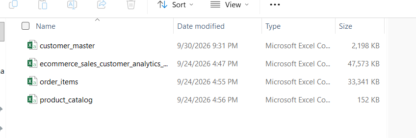

### 1.2. Vì sao có đề tài này

Quá trình hình thành đề tài đi theo 4 bước:

1. **Xem các trường dữ liệu.** File giao dịch có đầy đủ thông tin về đơn hàng (`order_date`, `net_sales`, `profit`, `quantity`), kênh bán và marketing (`sales_channel`, `marketing_channel`, `campaign_name`, `coupon_code`), thanh toán, giao hàng, trả hàng và đánh giá.
2. **Nhận thấy có thông tin chi tiết về khách hàng.** `customer_master` bổ sung tuổi, giới tính, phân khúc (`customer_segment`), địa lý. Ghép với lịch sử đơn hàng, mỗi khách hàng có thể được mô tả bằng *họ là ai* và *họ mua như thế nào*.
3. **Từ đó nảy ra mối quan tâm về hiệu quả marketing.** Ngân sách marketing có hạn, trong khi không phải khách hàng nào cũng đem lại giá trị như nhau, và nhiều khách đã lâu không quay lại. Câu hỏi tự nhiên là: *nên đầu tư vào ai, và nên làm gì với những khách đang rời đi?*
4. **Chốt thành câu hỏi kinh doanh.** Cần một cách phân loại khách hàng dựa trên **giá trị lợi nhuận** (họ đáng bao nhiêu) và **trạng thái hoạt động** (họ còn mua hay không).

### 1.3. Câu hỏi nghiên cứu

**Câu hỏi kinh doanh chính:**
> Làm thế nào để phân loại tập khách hàng hiện tại (**24,911 khách có phát sinh đơn hàng**) nhằm tối ưu hóa chi phí Marketing và gia tăng tỷ lệ giữ chân (Retention Rate)?

**Các câu hỏi phụ:**

1. Nhóm khách hàng nào mang lại **80% lợi nhuận** cho công ty (quy tắc Pareto)?
2. Tỷ lệ khách hàng có nguy cơ rời bỏ (**Churn Risk**) rơi vào **phân khúc hội viên** (`customer_segment`) nào nhiều nhất? Hành vi mua sắm gần đây nhất của nhóm Churn Risk đó là gì?
3. Đâu là **chân dung khách hàng có Basket Size** (giá trị đơn hàng trung bình) lớn nhất theo **độ tuổi, giới tính và quốc gia/vùng**?

> **Lưu ý về thuật ngữ:** dữ liệu không có cột `membership_tier`, nên "phân khúc hội viên" được hiểu là `customer_segment` (Consumer, Premium, Business, VIP). Dữ liệu địa lý được phân tích ở cấp **Quốc gia (`customer_country`) và Vùng (`region`)**.

---

## 2. Cấu trúc repo và quy trình tổng quan

```
.
├── data/
│   ├── raw/                # các file CSV gốc từ Kaggle
│   └── transformed/        # final_customer_analytics.csv (đầu ra sau SQL + Python)
├── sql/
│   ├── schema.sql          # cấu trúc các bảng trong SQLite
│   ├── queries.sql         # tạo bảng master_customer_summary
│   └── sqlite-database.db  # database SQLite
├── python/
│   └── rfm-transformed-notebook.ipynb
├── output/
│   └── power_bi/
│       └── dashboard.pbix  # dashboard Power BI
├── README.mdimages/        # ảnh dashboard dùng trong README
└── images/                 # ảnh dashboard dùng trong README
```

**Quy trình:**

```
4 file CSV (Kaggle)
   │  dùng ecommerce_sales + customer_master
   ▼
SQLite: JOIN + tổng hợp theo khách hàng  ──►  bảng master_customer_summary
   ▼
Python: chấm điểm RFM, gắn nhãn Pareto 80%  ──►  final_customer_analytics.csv
   ▼
Power BI: dashboard trả lời 3 câu hỏi phụ  ──►  Key insight
```

---

## 3. Database và SQL

Dữ liệu được nạp vào **SQLite** (cấu trúc bảng trong [`sql/schema.sql`](sql/schema.sql)). Hai bảng được sử dụng là `ecommerce_sales_customer_analytics_150k` và `customer_master`.

### 3.1. Mục đích

Tạo bảng `master_customer_summary` gồm **một dòng cho mỗi khách hàng**, chứa toàn bộ chỉ số cần cho 3 câu hỏi phụ: số đơn, doanh thu, lợi nhuận, basket size, số ngày kể từ lần mua cuối, trạng thái churn, và lợi nhuận tích lũy (phục vụ Pareto).

### 3.2. Ý tưởng luồng thực thi

Câu lệnh gồm 3 tầng, chạy lần lượt từ trong ra ngoài:

| Bước | Thành phần | Việc làm |
|---|---|---|
| 1 | CTE `order_summary` | Gộp bảng giao dịch theo `customer_id`: số đơn, tổng net sales, tổng lợi nhuận, ngày mua cuối, basket size |
| 2 | CTE `customer_aggregated` | `LEFT JOIN` từ `customer_master` sang `order_summary`; tạo `age_group`, `recency_days`, `churn_status` |
| 3 | `SELECT` cuối | Dùng Window Function để tính lợi nhuận tích lũy và phần trăm tích lũy, xếp từ khách lợi nhuận cao xuống thấp |

### 3.3. Câu lệnh SQL ([`sql/queries.sql`](sql/queries.sql))

```sql
CREATE TABLE IF NOT EXISTS master_customer_summary AS
WITH order_summary AS (
    SELECT 
        customer_id,
        COUNT(DISTINCT order_id) AS total_orders,
        SUM(net_sales) AS total_net_sales,
        SUM(profit) AS total_profit,
        MAX(order_date) AS last_order_date,
        ROUND(SUM(net_sales) * 1.0 / NULLIF(COUNT(DISTINCT order_id), 0), 2) AS avg_basket_size
    FROM ecommerce_sales_customer_analytics_150k
    GROUP BY customer_id),

customer_aggregated AS (
    SELECT 
        c.customer_id,
        c.customer_name,
        c.customer_age,
    
        CASE 
            WHEN c.customer_age < 25 THEN 'Under 25'
            WHEN c.customer_age BETWEEN 25 AND 34 THEN '25-34'
            WHEN c.customer_age BETWEEN 35 AND 44 THEN '35-44'
            WHEN c.customer_age BETWEEN 45 AND 54 THEN '45-54'
            ELSE '55+'
        END AS age_group,
        
        c.gender,
        c.customer_segment,
        c.customer_city,
        c.customer_country,
        c.region,

        COALESCE(o.total_orders, 0) AS total_orders,
        COALESCE(o.total_net_sales, 0) AS total_net_sales,
        COALESCE(o.total_profit, 0) AS total_profit,
        COALESCE(o.avg_basket_size, 0) AS avg_basket_size,
        
        CASE 
            WHEN o.last_order_date IS NULL THEN NULL 
            ELSE CAST(JULIANDAY('2025-12-31') - JULIANDAY(o.last_order_date) AS INTEGER) 
        END AS recency_days,
        
        CASE 
            WHEN o.last_order_date IS NULL THEN 'No Purchase'
            WHEN (JULIANDAY('2025-12-31') - JULIANDAY(o.last_order_date)) > 90 THEN 'Churn Risk'
            ELSE 'Active'
        END AS churn_status
    FROM customer_master c
    LEFT JOIN order_summary o ON c.customer_id = o.customer_id)

SELECT *,
    SUM(total_profit) OVER (ORDER BY total_profit DESC, customer_id ASC) AS cumulative_profit,
    ROUND(SUM(total_profit) OVER (ORDER BY total_profit DESC, customer_id ASC) * 100.0 / NULLIF(SUM(total_profit) OVER (), 0), 2) AS cum_profit_pct
FROM customer_aggregated;
```

### 3.4. Phân tích cấu trúc

- **`COUNT(DISTINCT order_id)`** thay vì `COUNT(*)`: đếm đúng số đơn ngay cả khi một đơn có nhiều dòng.
- **`NULLIF(..., 0)` và `* 1.0`**: tránh lỗi chia cho 0 và tránh phép chia số nguyên trong SQLite.
- **`LEFT JOIN` từ `customer_master`**: giữ lại cả khách chưa từng mua (nhận nhãn `No Purchase`), thay vì mất họ như `INNER JOIN`.
- **`COALESCE(..., 0)`**: khách không có đơn nhận giá trị 0 thay vì NULL; riêng `recency_days` giữ NULL vì "chưa từng mua" không có số ngày hợp lệ.
- **Churn Risk:** quá **90 ngày** kể từ lần mua cuối so với **ngày tham chiếu 31/12/2025** (ngày cuối của dữ liệu). Ngày này được ghi cố định trong câu lệnh để kết quả có thể tái lập.
- **Cửa sổ tích lũy `ORDER BY total_profit DESC, customer_id ASC`:** thêm `customer_id` làm tiêu chí phụ để thứ tự xác định khi nhiều khách có cùng lợi nhuận, tránh kết quả thay đổi giữa các lần chạy.
- **`SUM(...) OVER ()`:** tổng lợi nhuận toàn công ty làm mẫu số cho `cum_profit_pct`.

### 3.5. Ví dụ

Một khách hàng có 3 đơn, tổng net sales 3,000, lần mua cuối cách ngày 31/12/2025 là 120 ngày:

| total_orders | total_net_sales | avg_basket_size | recency_days | churn_status |
|---|---|---|---|---|
| 3 | 3,000 | 1,000.00 | 120 | Churn Risk |

---

## 4. Python: RFM và Pareto

Notebook: [`notebook/rfm-transformed-notebook.ipynb`](notebook/rfm-transformed-notebook.ipynb)

### 4.1. Mục đích

Từ bảng `master_customer_summary`: (1) chấm điểm **RFM** và phân nhóm hành vi, (2) gắn nhãn **Pareto 80%** cho từng khách, (3) xuất file `final_customer_analytics.csv` để dựng dashboard.

### 4.2. Đọc dữ liệu từ SQLite và lọc dòng thiếu

```python
import pandas as pd
import numpy as np
import sqlite3

conn = sqlite3.connect(db_path)
df = pd.read_sql_query("SELECT * FROM master_customer_summary", conn)
conn.close()

df = df.dropna(subset=['recency_days', 'total_orders', 'total_net_sales', 'cum_profit_pct'])
```

- **Mục đích:** nạp bảng tổng hợp vào pandas và loại các khách không có dữ liệu để tính RFM.
- **Cấu trúc:** `dropna` trên 4 cột đầu vào của RFM và Pareto. Khách chưa từng mua có `recency_days = NULL` nên bị loại.
- **Ví dụ:** 25,000 khách trong `customer_master` còn **24,911** khách có đơn hàng; 89 khách chưa mua bị loại.

### 4.3. Chấm điểm RFM (thang 1–5)

```python
df['R_score'] = pd.qcut(df['recency_days'].rank(method='first'), 5, labels=[5, 4, 3, 2, 1]).astype(int)
df['F_score'] = pd.qcut(df['total_orders'].rank(method='first'), 5, labels=[1, 2, 3, 4, 5]).astype(int)
df['M_score'] = pd.qcut(df['total_net_sales'].rank(method='first'), 5, labels=[1, 2, 3, 4, 5]).astype(int)
```

- **Mục đích:** biến 3 chỉ số thô (số ngày kể từ lần mua cuối, số đơn, tổng doanh thu) thành điểm 1–5 để so sánh được.
- **Cấu trúc:**
  - `qcut` chia khách thành **5 nhóm có số lượng bằng nhau** (quintile).
  - `.rank(method='first')` loại bỏ các giá trị trùng trước khi chia. Nếu bỏ bước này, `qcut` dễ báo lỗi do nhiều khách có cùng số đơn.
  - **Recency được đảo nhãn `[5,4,3,2,1]`**: số ngày càng ít (mua càng gần đây) thì điểm càng cao.
- **Ví dụ:** khách mua cách đây 10 ngày thuộc nhóm 20% gần nhất nên `R = 5`; khách có tổng doanh thu thuộc 20% thấp nhất nên `M = 1`.

### 4.4. Phân nhóm RFM

```python
r, f, m = df['R_score'], df['F_score'], df['M_score']
df['rfm_segment'] = np.select(
    [(r >= 4) & (f >= 4) & (m >= 4), (r >= 3) & (f >= 3), (r >= 3) & (f <= 2), (r <= 2) & (f >= 3), ],
    ['Champions', 'Loyal Customers', 'Potential Loyalists', 'At Risk'], default='Lost / Hibernating')
```

- **Mục đích:** gán mỗi khách vào một nhóm hành vi dễ hiểu.
- **Cấu trúc:** `np.select` xét điều kiện **theo thứ tự từ trên xuống**, điều kiện đầu tiên thỏa sẽ được áp dụng. Vì vậy Champions được kiểm tra trước Loyal.

| Nhóm | Điều kiện |
|---|---|
| Champions | R ≥ 4, F ≥ 4, M ≥ 4 |
| Loyal Customers | R ≥ 3, F ≥ 3 (và chưa là Champions) |
| Potential Loyalists | R ≥ 3, F ≤ 2 |
| At Risk | R ≤ 2, F ≥ 3 |
| Lost / Hibernating | Các trường hợp còn lại |

- **Ví dụ:** R=5, F=5, M=4 là Champions. R=4, F=4, M=3 là Loyal Customers (vì M chưa đạt 4). R=2, F=4 là At Risk: từng mua nhiều nhưng đã lâu không quay lại.

### 4.5. Gắn nhãn Pareto 80%

```python
df = df.sort_values('cum_profit_pct')
prev_cum = df['cum_profit_pct'].shift(fill_value=0)
df['is_pareto_80'] = np.where(prev_cum < 80, 'Top 80% Profit (Pareto)', 'Remaining 20% Profit')
```

- **Mục đích:** tách nhóm khách tạo ra 80% lợi nhuận tích lũy.
- **Cấu trúc:**
  - Sắp theo `cum_profit_pct` tăng dần, tức là từ khách lợi nhuận cao nhất xuống thấp nhất.
  - `shift()` lấy giá trị tích lũy **của khách ngay trước đó**. Khách nào có mức tích lũy trước đó **dưới 80%** thì thuộc nhóm Pareto. Cách này bao gồm cả khách "vượt vạch 80%", nên nhóm Pareto đạt đủ 80% lợi nhuận.
- **Ví dụ:** khách A có tích lũy trước đó là 79.99% thì vào nhóm Pareto dù bản thân A đẩy tổng lên 80.01%. Khách kế tiếp có tích lũy trước đó 80.01% thì thuộc nhóm còn lại.

### 4.6. Xuất file

```python
df.to_csv(output_path, index=False, encoding='utf-8-sig')
print(df['rfm_segment'].value_counts())
```

`utf-8-sig` giúp Excel và Power BI đọc đúng ký tự. Kết quả: `final_customer_analytics.csv` (24,911 dòng × 22 cột).

---

## 5. Tóm tắt kết quả sau SQL và Python

| Hạng mục | Kết quả |
|---|---|
| Số khách hàng trong phân tích | **24,911** (đã loại 89 khách chưa mua) |
| Tổng lợi nhuận | **≈ $76.15M** |
| Churn Risk (>90 ngày) | 17,469 khách (**70.1%**) |
| Active (≤90 ngày) | 7,442 khách (**29.9%**) |
| Nhóm Pareto 80% | 14,535 khách (**58.3%** khách), lợi nhuận $60.91M |
| Nhóm còn lại 20% | 10,376 khách (41.7% khách), lợi nhuận $15.23M |

Phân bố nhóm RFM:

| Nhóm RFM | Số khách |
|---|---|
| Loyal Customers | 6,954 |
| Lost / Hibernating | 5,560 |
| Potential Loyalists | 4,405 |
| At Risk | 4,404 |
| Champions | 3,588 |

> **Nhận xét quan trọng:** 80% lợi nhuận đến từ **58.3% số khách**, không phải 20% như quy tắc Pareto kinh điển. Lợi nhuận trong tập dữ liệu này **phân bổ khá đều**, không tập trung vào một nhóm nhỏ. Nhãn "Pareto" trong dự án nên hiểu là *nhóm khách tạo ra 80% lợi nhuận tích lũy*.

---

## 6. Power BI Dashboard: trả lời 3 câu hỏi phụ

File `final_customer_analytics.csv` được đưa vào Power BI. Tổng quan dashboard:

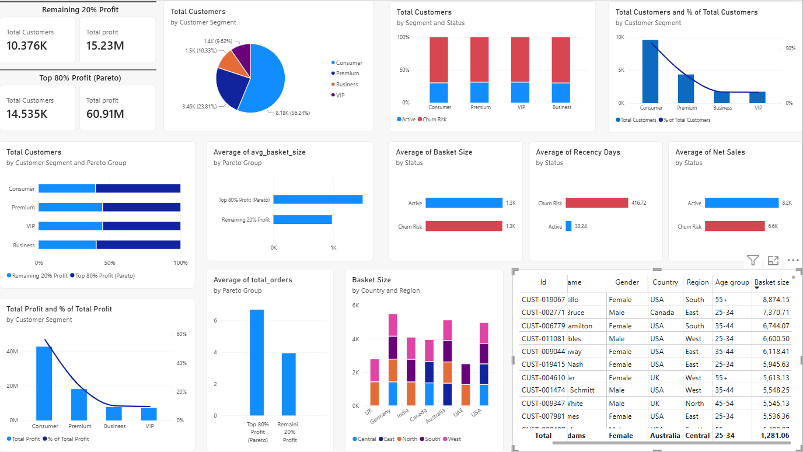

### 6.1. Câu hỏi 1: Nhóm khách hàng nào mang lại 80% lợi nhuận (Pareto)?

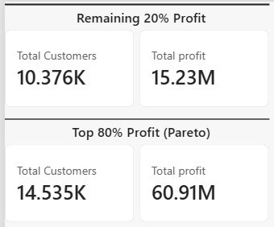

**Kết quả:** **14,535 khách** (58.3%) tạo ra **$60.91M** (80%) tổng lợi nhuận. 10,376 khách còn lại tạo ra $15.23M (20%).

**Cơ cấu nhóm Pareto theo phân khúc:**

| Phân khúc | Số khách trong nhóm Pareto | % nhóm Pareto | % lợi nhuận của nhóm Pareto | Tỷ lệ khách của phân khúc lọt vào Pareto |
|---|---|---|---|---|
| Consumer | 8,175 | 56.24% | 57.1% | 60.18% |
| Premium | 3,461 | 23.81% | 23.2% | 55.16% |
| Business | 1,501 | 10.33% | 10.4% | 59.68% |
| VIP | 1,398 | 9.62% | 9.4% | 55.13% |

| Cơ cấu khách theo phân khúc | Khách theo nhóm Pareto trong từng phân khúc |
|---|---|
| 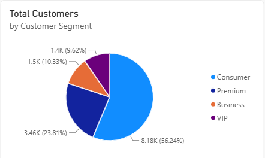 | 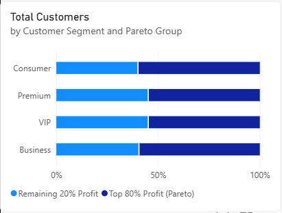 |

| Lợi nhuận theo phân khúc | % khách theo phân khúc |
|---|---|
| 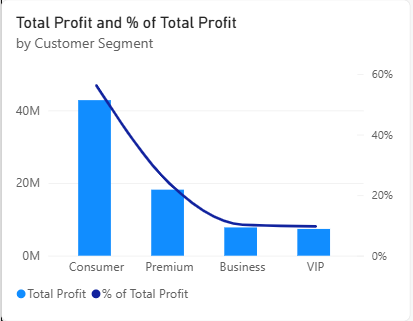 | 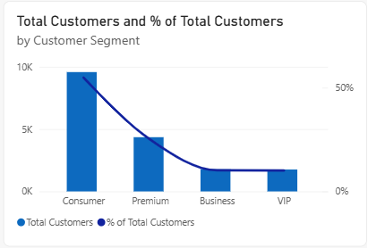 |

**Điều gì phân biệt nhóm Pareto?** Không phải tuổi hay giới tính, mà là **tần suất mua** và **giá trị đơn hàng**:

| Chỉ số | Nhóm Pareto | Nhóm còn lại |
|---|---|---|
| Số đơn trung bình / khách | **6.69** | 3.94 |
| Basket size trung bình | **$1,495.58** | $980.56 |

| Basket size theo nhóm | Số đơn theo nhóm |
|---|---|
| 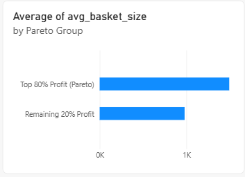 | 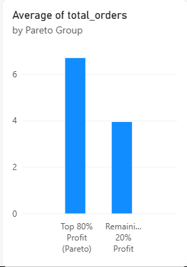 |

**Kết luận:** Consumer đóng góp nhiều nhất về quy mô (đông khách nhất). Về tỷ lệ lọt vào nhóm Pareto, **Consumer (60.18%) và Business (59.68%)** cao hơn Premium và VIP (~55%). Cấp độ phân khúc **không** đồng nghĩa với lợi nhuận cao hơn: lợi nhuận trung bình mỗi khách của 4 phân khúc gần nhau ($2,897 – $3,152).

### 6.2. Câu hỏi 2: Churn Risk rơi vào phân khúc nào nhiều nhất, và họ mua sắm ra sao?

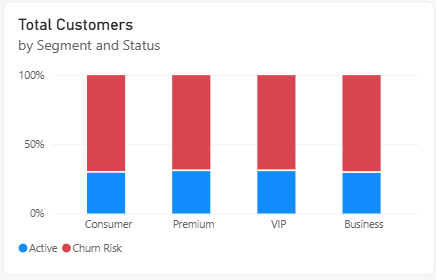

| Phân khúc | Số khách Churn Risk | % tổng Churn Risk | Tỷ lệ Churn trong nội bộ phân khúc |
|---|---|---|---|
| **Consumer** | **9,580** | **54.84%** | 70.5% |
| Premium | 4,353 | 24.92% | 69.4% |
| Business | 1,777 | 10.17% | 70.7% |
| VIP | 1,759 | 10.07% | 69.4% |

**Kết quả:** Consumer có nhiều khách Churn Risk nhất về **số lượng**, nhưng chủ yếu vì đây là phân khúc **đông khách nhất**. Xét **tỷ lệ**, cả 4 phân khúc đều ở mức **69.4% – 70.7%**, gần như bằng nhau. Phân khúc hội viên **không** giải thích được việc khách rời đi.

**Hành vi mua sắm gần đây của nhóm Churn Risk:**

| Chỉ số | Active | Churn Risk (toàn bộ) | Churn Risk, riêng Consumer |
|---|---|---|---|
| Số ngày kể từ lần mua cuối (recency) | 38.24 | 416.72 | 417.3 (~1.1 năm) |
| Số đơn trung bình | 6.4 | 5.2 | 5.20 |
| Basket size trung bình | ~$1.3K | ~$1.3K | $1,284.40 |
| Tổng net sales trung bình / khách | $8.2K | $6.6K | $6,676.90 |

| Basket size theo trạng thái | Recency theo trạng thái | Net sales theo trạng thái |
|---|---|---|
| 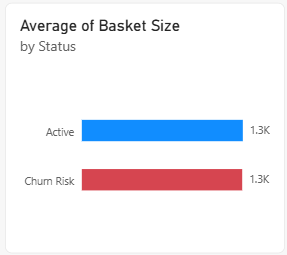 | 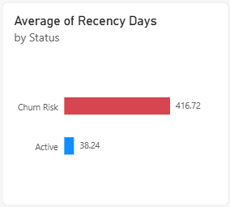 | 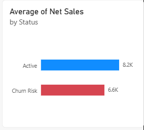 |

**Nhận định:** giá trị mỗi đơn của nhóm Churn Risk **không thấp hơn** nhóm Active. Họ khác nhau ở chỗ nhóm Churn Risk **ngừng quay lại sau trung bình khoảng 5 đơn**. Dữ liệu cho thấy mối liên hệ này, nhưng chưa đủ để kết luận nguyên nhân.

### 6.3. Câu hỏi 3: Chân dung khách hàng có Basket Size lớn nhất

**Theo quốc gia và vùng** (basket size trung bình):

| Quốc gia | Basket size TB | Số khách |
|---|---|---|
| UK | $1,386.92 | 3,689 |
| Germany | $1,373.26 | 2,039 |
| India | $1,356.22 | 1,035 |
| Canada | $1,311.35 | 1,272 |
| Australia | $1,280.95 | 1,226 |
| UAE | $1,240.69 | 771 |
| USA | $1,236.47 | 14,879 |

Vùng cao nhất: UK - North ($1,394.88), Germany - Central ($1,390.92), India - North ($1,388.92). Chênh lệch giữa top 3 chỉ khoảng 2%, còn giữa UK và USA khoảng 12%.

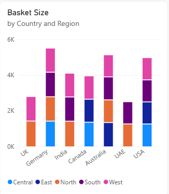

**Chân dung nhóm Top 500 khách có Basket Size lớn nhất:**

| Tiêu chí | Kết quả |
|---|---|
| Giới tính | Nữ **50.8%**, Nam 45.8%, Non-Binary 3.4% |
| Độ tuổi | **55+ nổi bật nhất: 179 khách (35.8%)**; 35–44: 92; 45–54: 88; 25–34: 86; Dưới 25: 55 |
| Quốc gia | USA 225 khách, UK 119, Germany 63, Australia 30, Canada 29 |

> **Cách đọc đúng:** USA có nhiều khách nhất trong Top 500 chỉ vì USA có **cơ sở khách lớn nhất** (14,879 khách, ~60%). Xét **tỷ lệ khách lọt Top 500 trên số khách của từng nước**, UK (3.23%) và Germany (3.09%) vượt trội, còn USA thấp nhất (1.51%).

**Khách hàng có Basket Size cao nhất:** `CUST-019067` (Julie Castillo), 70 tuổi (nhóm 55+), Nữ, USA - South, **$8,874.15 / đơn**.

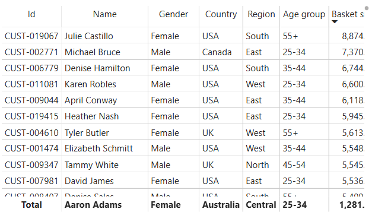

**Kết luận:** chân dung khách có basket lớn có xu hướng là **nữ, nhóm tuổi 55+**, tập trung ở **UK và Germany** nếu xét theo tỷ lệ. Đây là xu hướng mô tả, các chênh lệch giữa nhóm nhỏ và cần kiểm định thêm trước khi dùng làm cơ sở nhắm mục tiêu.

---

## 7. Key Insight: trả lời câu hỏi kinh doanh chính

> **Làm thế nào để phân loại khách hàng nhằm tối ưu chi phí Marketing và gia tăng tỷ lệ giữ chân?**

### 7.1. Ba phát hiện nền tảng

1. **Giá trị không tập trung:** 58.3% khách tạo ra 80% lợi nhuận. Không có "nhóm nhỏ siêu giá trị", nên chiến lược không nên dồn hết vào một nhóm hẹp.
2. **Churn lan rộng, phân khúc không phải đòn bẩy:** khoảng 70% khách ở **mọi** phân khúc bị đánh dấu Churn Risk. Không thể dùng `customer_segment` để quyết định ai cần giữ chân.
3. **Lợi nhuận nằm nhiều ở khách Churn Risk:** nhóm Churn Risk tạo ra khoảng **$50.5M (66%)** tổng lợi nhuận lịch sử, đây là phần đang bị đe dọa.

### 7.2. Ma trận 4 nhóm chiến lược (Giá trị × Trạng thái)

Phân loại bằng 2 trục: **Pareto 80%** (giá trị) và **Active / Churn Risk** (trạng thái).

| | **Active** | **Churn Risk** |
|---|---|---|
| **Pareto 80% (giá trị cao)** | **Nhóm 1: Core Revenue Heroes**<br>5,026 khách (20.2%)<br>28.7% lợi nhuận<br>Basket TB $1,440 | **Nhóm 2: High-Priority Win-back**<br>9,509 khách (38.2%)<br>**51.3% lợi nhuận**<br>Basket TB $1,525 |
| **Remaining 20% (giá trị thấp)** | **Nhóm 3: Potential Nurture**<br>2,416 khách (9.7%)<br>5.0% lợi nhuận<br>Basket TB $962 | **Nhóm 4: Low-Touch Automation**<br>7,960 khách (32.0%)<br>15.0% lợi nhuận<br>Basket TB $986 |

### 7.3. Chiến lược đề xuất cho từng nhóm

**Nhóm 1: Core Revenue Heroes (Active + Pareto)** · *Giữ chân bằng trải nghiệm*
- Đặc điểm: đang mua đều và đóng góp lợi nhuận lớn.
- Hướng làm: hạn chế giảm giá đại trà để không bào mòn biên lợi nhuận; ưu tiên đặc quyền (giao nhanh, chăm sóc ưu tiên, truy cập sản phẩm mới sớm), gợi ý combo để tăng basket.
- Chi phí marketing: **thấp**.

**Nhóm 2: High-Priority Win-back (Churn Risk + Pareto)** · *Trọng tâm tăng Retention*
- Đặc điểm: từng đóng góp lợi nhuận rất cao nhưng đã trung bình khoảng 347 ngày không quay lại. Đây là nhóm lớn nhất và giữ hơn một nửa lợi nhuận.
- Hướng làm: chiến dịch win-back cá nhân hóa dựa trên lịch sử mua; thử ưu đãi cho đơn kế tiếp.
- Chi phí marketing: **cao**, là nơi nên ưu tiên đầu tư.
- **Cần chia nhỏ nhóm này bằng RFM** (xem 7.5), vì 9,509 khách là quá lớn để áp một kịch bản duy nhất.

**Nhóm 3: Potential Nurture (Active + Remaining)** · *Đẩy lên nhóm giá trị cao*
- Đặc điểm: vẫn đang mua nhưng basket nhỏ (~$962).
- Hướng làm: gợi ý sản phẩm bổ sung, đặt ngưỡng quà tặng hoặc freeship cao hơn basket hiện tại để kéo giá trị đơn lên mức nhóm Pareto (~$1,400+).
- Chi phí marketing: **trung bình**.

**Nhóm 4: Low-Touch Automation (Churn Risk + Remaining)** · *Tối ưu chi phí*
- Đặc điểm: giá trị thấp, basket nhỏ, đã rời đi lâu.
- Hướng làm: giảm mạnh quảng cáo trả phí; chỉ chạy kịch bản tự động chi phí thấp (email, tin nhắn tự động).
- Chi phí marketing: **thấp nhất**.

### 7.4. Phân bổ ngân sách và ước tính tác động (giả định, chưa kiểm chứng)

> Các con số dưới đây là **đề xuất mang tính giả định** để minh họa cách ưu tiên. Dữ liệu hiện tại **không có chi phí marketing theo khách hàng**, nên chưa thể tính ROI thực.

| Nhóm | Gợi ý tỷ trọng ngân sách |
|---|---|
| Nhóm 2 (Win-back) | ~60% |
| Nhóm 3 (Nurture) | ~25% |
| Nhóm 1 (Giữ chân bằng dịch vụ) | ~15% |
| Nhóm 4 | Gần như bằng 0, chỉ dùng automation |

**Ví dụ minh họa:** nếu khôi phục được 10% nhóm 2 (khoảng 950 khách), với lợi nhuận lịch sử trung bình ~$4,100 mỗi khách, phần lợi nhuận tương ứng khoảng **$3.9M** (tính trên lịch sử 5 năm). Đây là quy mô cơ hội, **không phải dự báo doanh thu**.

### 7.5. Hướng phát triển tiếp theo

- **Chia nhỏ Nhóm 2 bằng RFM** (đã tính sẵn trong notebook nhưng chưa dùng trên dashboard): ưu tiên nhóm `At Risk` (4,404 khách, từng mua nhiều nhưng lâu không quay lại); nhóm `Champions` đang bị gắn Churn Risk (850 khách) cần chăm sóc cá nhân hóa.
- **Hiệu chỉnh ngưỡng churn** theo chu kỳ mua thực tế của khách (xem mục 8).
- **Gắn chi phí marketing** (`marketing_channel`, `campaign_name`, `customer_acquisition_cost`) để tính ROI từng nhóm.
- **Kiểm chứng bằng A/B test** trước khi triển khai ngân sách thật.

---

## 8. Hạn chế

**Về định nghĩa và phương pháp**

- **Ngưỡng Churn 90 ngày có thể quá chặt.** Dữ liệu trải 5 năm, mỗi khách trung bình chỉ có khoảng 5.5 đơn, nên khoảng cách giữa hai lần mua thường dài hơn nhiều so với 90 ngày. Kết quả là ~70% khách bị gắn Churn Risk và tỷ lệ này gần như bằng nhau ở mọi phân khúc. Ngưỡng nên xây theo chu kỳ mua riêng của từng khách hoặc từng ngành hàng.
- **Hai cách đo "mới mua gần đây" chưa nhất quán.** Nhãn Churn dùng ngưỡng 90 ngày cố định, còn điểm R trong RFM dùng phân vị. Vì vậy có 850 khách vừa là `Champions` vừa là `Churn Risk`.
- **"Pareto" không theo tỷ lệ 80/20.** 80% lợi nhuận đến từ 58.3% khách. Nhãn `Remaining 20% Profit` chỉ nói về **phần lợi nhuận**, không phải 20% số khách.
- **Ranh giới 80% có sai lệch rất nhỏ.** `cum_profit_pct` được làm tròn 2 chữ số, nên vài khách sát ngưỡng 80% có thể được xếp khác nhau tùy thứ tự khi bằng nhau. Ảnh hưởng không đáng kể trên 24,911 khách.
- **RFM chia theo thứ hạng:** `rank(method='first')` phá thế hòa theo thứ tự dòng, nên hai khách có cùng số đơn có thể nhận điểm F khác nhau. Điều này làm các nhóm có kích thước đều nhưng không hoàn toàn khách quan.
- **Ngày tham chiếu cố định** (`2025-12-31`) trong SQL. Khi dùng dữ liệu mới cần đổi ngày này.

**Về chất lượng dữ liệu**

- **`net_sales` bao gồm cả đơn `Cancelled`, `Returned` và `Pending`** (khoảng 19% tổng net sales, ≈ $33M / $177M). Lợi nhuận và basket size có thể bị phóng đại so với doanh thu thực. Hướng cải thiện: chỉ tính đơn `Completed`.
- **23 khách có lợi nhuận âm**, được giữ nguyên trong phân tích.
- **89 khách chưa từng mua** bị loại khỏi phân tích RFM và dashboard.
- Tên file ghi "150k" nhưng file giao dịch thực tế có **138,116 dòng**.

**Về phạm vi và cách diễn giải**

- Đề tài ban đầu nhắm đến **chi phí marketing**, nhưng các cột chi phí và chiến dịch **chưa được sử dụng**. Phần ngân sách ở mục 7.4 vì thế chỉ là giả định.
- Đây là **phân tích mô tả** dựa trên tương quan; chưa kiểm chứng nguyên nhân khách rời đi hay hiệu quả của các biện pháp giữ chân.
- Q3 phân tích theo **quốc gia/vùng**, chưa xuống cấp thành phố. Chênh lệch basket giữa các quốc gia top đầu rất nhỏ (~2%).
- Biểu đồ cột chồng *Basket Size by Country and Region* cộng các giá trị trung bình của từng vùng, vì vậy nên đọc từng vùng riêng lẻ thay vì so tổng chiều cao cột giữa các quốc gia.

---

## 9. Cách chạy lại dự án

1. Tải bộ dữ liệu từ Kaggle (4 file CSV) và nạp vào SQLite (ví dụ bằng DB Browser for SQLite), tạo các bảng theo [`sql/schema.sql`](sql/schema.sql).
2. Chạy [`sql/queries.sql`](sql/queries.sql) để tạo bảng `master_customer_summary`.
3. Mở notebook, **sửa `db_path` và `output_path`** trỏ về đường dẫn trên máy bạn (notebook đang dùng đường dẫn Windows cục bộ), rồi chạy lần lượt các cell.
4. Nạp `final_customer_analytics.csv` vào Power BI để dựng dashboard.

**Yêu cầu:** Python 3, `pandas`, `numpy`, `sqlite3` (có sẵn), Jupyter; Power BI Desktop.
